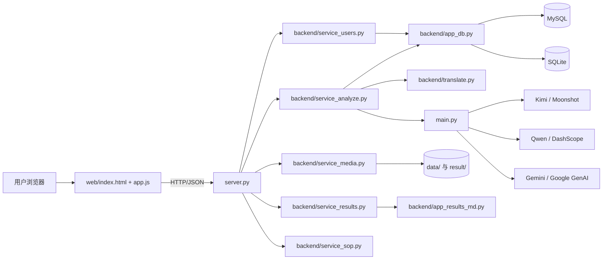
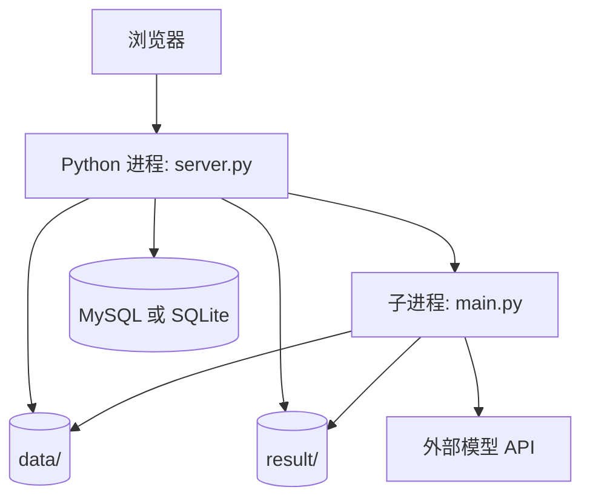
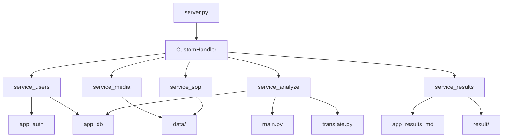
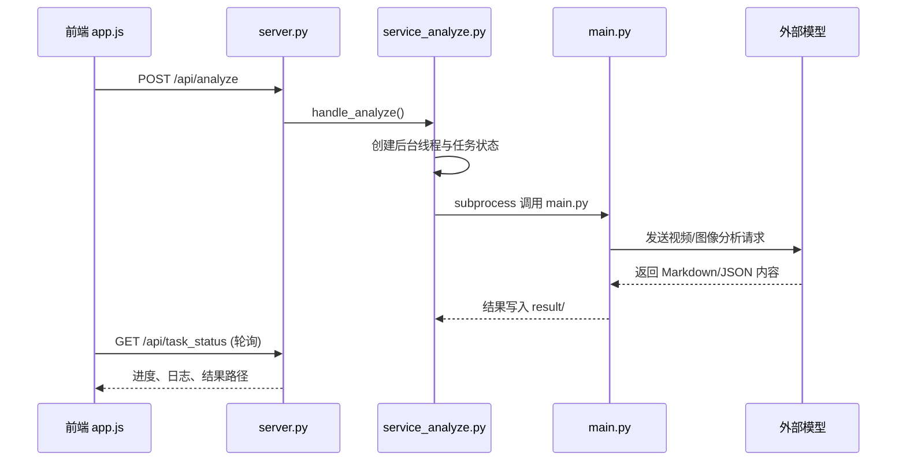
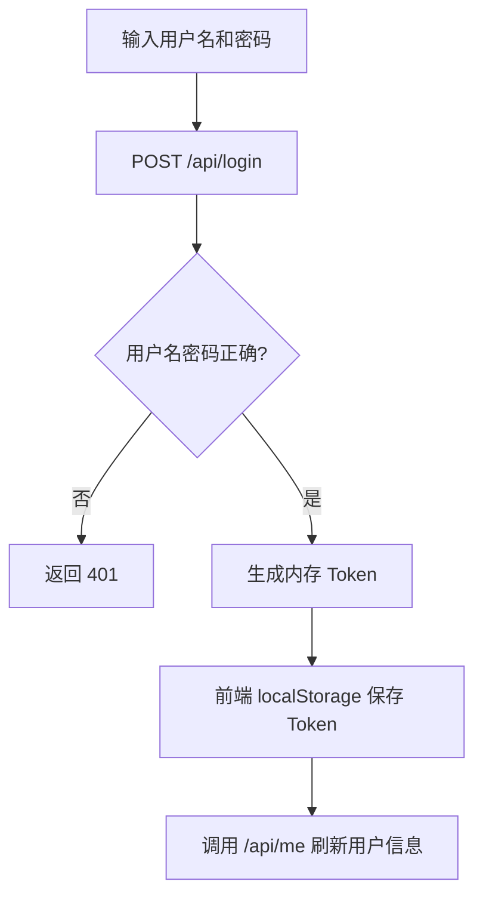
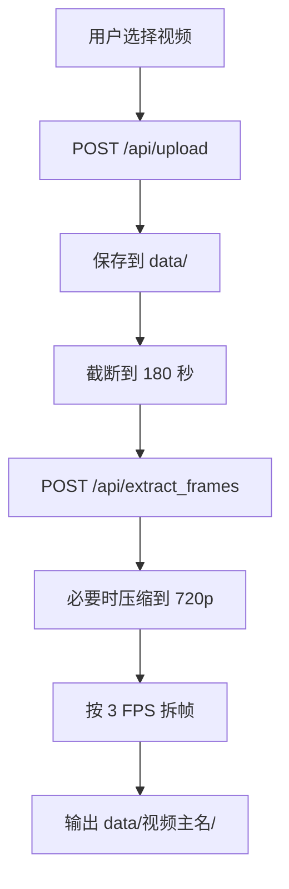
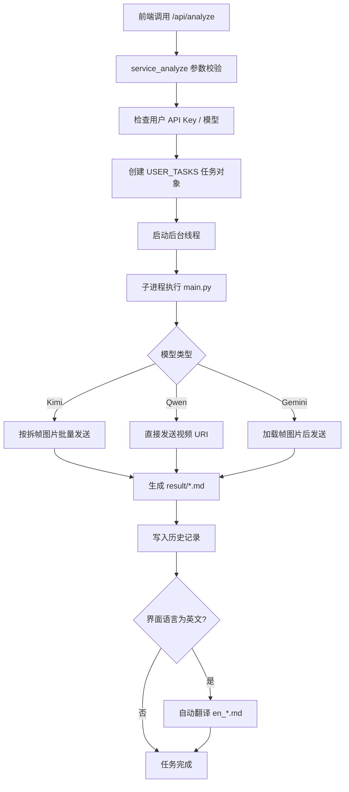
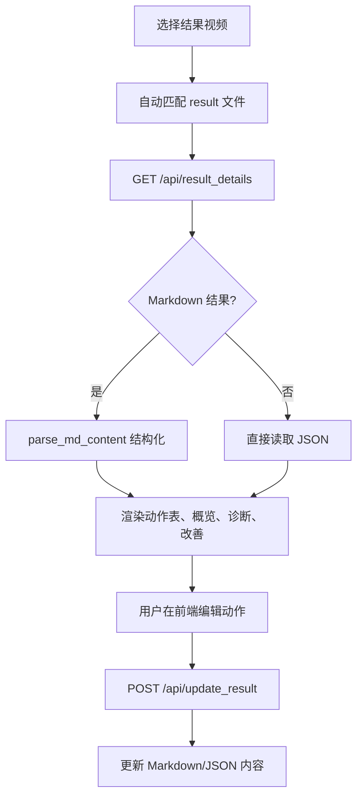
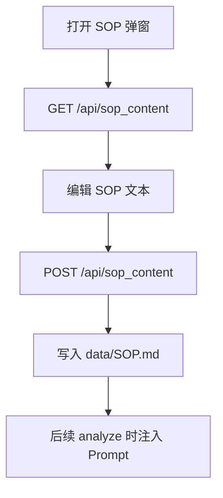
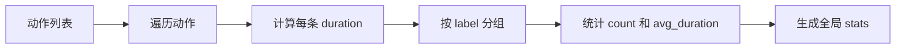

# Geniview 视频动作分析系统设计文档

## 1. 文档说明

本文档面向开发、测试、实施与运维人员，对本工程的总体设计、软件结构、接口设计、模块职责、核心函数、算法逻辑与运行机制进行说明。项目当前形态为一个基于 Python 的本地 Web 应用，采用静态前端 + 轻量 HTTP 服务 + 多模型视频分析引擎的组合方式，支持视频上传、拆帧、AI 分析、结果查看、结果修订、用户管理、SOP 管理与中英双语结果输出。

## 2. 系统定位

### 2.1 建设目标

- 提供一个面向生产/工序视频的动作分析平台
- 通过大模型对视频或拆帧图像进行动作识别、统计与改善建议生成
- 允许业务人员在 Web 界面中查看结果、播放视频、编辑动作表
- 管理不同用户的 API Key、模型偏好与检测历史
- 将分析结果保存为 `Markdown` 或 `JSON`，便于复核、归档与翻译

### 2.2 设计原则

- 本地优先：默认在 IDE/本机环境中运行，不依赖复杂中间件
- 单体拆分：逻辑上按用户、媒体、分析、结果、SOP 模块拆分
- 低耦合：前端通过 REST API 与后端交互
- 可回退：数据库支持 MySQL 与 SQLite 自动切换
- 可扩展：分析模型支持 Kimi、Qwen、Gemini 多后端

## 3. 技术栈

| 层次 | 技术 | 用途 |
| :--- | :--- | :--- |
| 前端 | HTML / CSS / JavaScript | 页面展示、交互、任务轮询、结果编辑 |
| 图表 | Chart.js | 动作统计柱状图 |
| 服务端 | Python 标准库 `http.server` | 静态资源托管与 API 路由 |
| 视频处理 | OpenCV、ffmpeg、ffprobe、Pillow | 拆帧、压缩、时长探测、图像编码 |
| AI SDK | `openai`、`dashscope`、`google-genai` | Kimi / Qwen / Gemini 模型调用 |
| 数据库 | MySQL / SQLite | 用户、检测历史持久化 |
| 容器化 | Docker / docker-compose | 部署打包与生产运行 |

## 4. 总体架构设计

### 4.1 逻辑架构图



### 4.2 物理部署图



### 4.3 分层说明

| 分层 | 组成 | 职责 |
| :--- | :--- | :--- |
| 表现层 | `web/` | 登录、任务提交、进度显示、结果查看与编辑 |
| 路由层 | `server.py` | URL 分发、鉴权拦截、静态文件输出、CORS 处理 |
| 业务层 | `backend/service_*.py` | 用户管理、媒体处理、分析任务、结果处理、SOP 管理 |
| 核心引擎层 | `main.py` | 多模型适配、拆帧输入组织、统计计算、结果输出 |
| 数据层 | `backend/app_db.py` | 用户表、历史表、MySQL/SQLite 兼容 |
| 文件层 | `data/`、`result/` | 原始视频、拆帧图片、分析结果、复制后视频 |

## 5. 目录结构设计

```text
gemini 2/
├── backend/
│   ├── app_auth.py
│   ├── app_config.py
│   ├── app_db.py
│   ├── app_results_md.py
│   ├── service_analyze.py
│   ├── service_media.py
│   ├── service_results.py
│   ├── service_sop.py
│   ├── service_users.py
│   └── translate.py
├── web/
│   ├── assets/app.js
│   ├── pages/*.html
│   ├── styles/app.css
│   └── index.html
├── docker/
├── docs/
├── main.py
├── server.py
└── requirements.txt
```

## 6. 软件结构设计

### 6.1 核心模块关系图



### 6.2 前后端交互结构图



## 7. 功能模块设计

### 7.1 功能总览

| 模块 | 页面/文件 | 功能说明 |
| :--- | :--- | :--- |
| 登录鉴权 | `web/index.html`、`service_users.py`、`app_auth.py` | 用户登录、Bearer Token 鉴权 |
| 视觉检测 | `pages/detection.html`、`service_media.py`、`service_analyze.py` | 视频上传、拆帧、后台分析、进度查看 |
| 结果查看 | `pages/review.html`、`service_results.py`、`app_results_md.py` | 视频回看、动作表展示、统计图、建议查看 |
| 结果修订 | `app.js`、`service_results.py` | 前端编辑动作并回写 Markdown/JSON |
| 用户管理 | `pages/users.html`、`service_users.py`、`app_db.py` | 用户新增、编辑、模型/API Key 配置 |
| SOP 管理 | `service_sop.py` | SOP 内容读取与保存 |
| 翻译 | `translate.py` | 中文技术 Markdown 自动翻译为英文 |
| 配置与运行 | `app_config.py`、`server.py` | 端口、数据库、并发、版本等配置 |

### 7.2 页面设计

| 页面 | 入口文件 | 主要组件 | 说明 |
| :--- | :--- | :--- | :--- |
| 登录页 | `web/index.html` | 用户名、密码、登录按钮 | 未登录时覆盖主界面 |
| 视觉检测页 | `web/pages/detection.html` | 视频选择、上传、任务进度、日志面板 | 负责发起检测任务 |
| 结果查看页 | `web/pages/review.html` | 视频播放器、动作列表、时间轴、统计图、编辑框 | 负责回看与校正结果 |
| 用户管理页 | `web/pages/users.html` | 用户列表、用户编辑弹窗、历史弹窗 | 仅管理员可见 |
| 设置页 | `web/pages/settings.html` | 主题切换、语言切换、版本展示 | UI 配置 |
| 费用计算器 | `web/pages/calculator.html` | Token 输入输出费用估算 | 仅管理员可见 |

## 8. 模块详细设计

### 8.1 路由与服务入口模块

#### 8.1.1 `server.py`

职责：

- 启动 HTTP 服务
- 输出 `web/` 静态资源
- 分发所有 `/api/*` 请求
- 执行统一鉴权、CORS、文件下载与分段传输

主要类与函数：

| 名称 | 类型 | 功能 |
| :--- | :--- | :--- |
| `CustomHandler` | 类 | 继承 `SimpleHTTPRequestHandler`，统一处理 API 与静态资源 |
| `send_json()` | 方法 | 输出 JSON 响应 |
| `get_auth_user()` | 方法 | 解析 Bearer Token |
| `require_auth()` | 方法 | 鉴权失败时直接返回 `401` |
| `end_headers()` | 方法 | 注入跨域头、缓存头 |
| `do_POST()` | 方法 | 处理登录、用户维护、上传、拆帧、分析、SOP 写入等 |
| `do_GET()` | 方法 | 处理版本、用户信息、历史、结果、视频信息、静态资源 |
| `do_HEAD()` | 方法 | 支持视频与结果文件的 HEAD/Range 能力 |
| `ReusableThreadingTCPServer` | 类 | 支持地址复用的多线程 TCP 服务 |

设计说明：

- 采用单进程多线程 HTTP 模型，满足本地工具型系统需求
- API 与静态资源共用一个端口，简化部署
- 对 `data/` 与 `result/` 文件访问加入路径归一化与目录越界检查

### 8.2 配置模块

#### 8.2.1 `backend/app_config.py`

| 配置项 | 说明 | 默认值 |
| :--- | :--- | :--- |
| `VERSION` | 应用版本号 | `v2.3` |
| `PORT` | HTTP 服务端口 | `8000` |
| `MYSQL_HOST` | MySQL 主机 | `127.0.0.1` |
| `MYSQL_PORT` | MySQL 端口 | `3306` |
| `MYSQL_USER` | MySQL 用户 | `root` |
| `MYSQL_PASSWORD` | MySQL 密码 | `123456` |
| `MYSQL_DATABASE` | 数据库名 | `geniview` |
| `TOKEN_TTL_SECONDS` | Token 有效期 | 8 小时 |
| `ANALYZE_CONCURRENCY` | 后台分析并发数 | `1` |

设计说明：

- 优先从环境变量读取，兼容 `.env`
- 数据库默认使用 `127.0.0.1`，规避 `localhost` 触发 socket 认证问题

### 8.3 鉴权模块

#### 8.3.1 `backend/app_auth.py`

| 函数名 | 功能 |
| :--- | :--- |
| `create_token()` | 为登录成功用户创建随机 Token，并附带过期时间 |
| `get_token_info()` | 校验 Token 是否存在与是否过期 |

设计说明：

- 当前 Token 存储于进程内内存 `TOKENS` 字典
- 服务重启后 Token 会失效
- 适用于本地或轻量部署场景，不适合作为跨实例共享会话方案

### 8.4 数据访问模块

#### 8.4.1 `backend/app_db.py`

职责：

- 管理 MySQL 与 SQLite 双实现
- 初始化用户表与检测历史表
- 提供用户、历史、模型/API Key 查询接口
- 提供密码散列与校验能力

主要函数：

| 函数名 | 功能 |
| :--- | :--- |
| `_mysql_available()` | 检查 MySQL 驱动是否可用 |
| `get_db_connection()` | 获取 MySQL 连接 |
| `_get_sqlite_connection()` | 获取 SQLite 连接 |
| `hash_password()` | 使用 PBKDF2-HMAC-SHA256 生成密码散列 |
| `verify_password()` | 校验明文密码与散列密码 |
| `ensure_database()` | 根据 `DB_MODE` 初始化 MySQL 或 SQLite |
| `_ensure_mysql()` | 创建 MySQL 库、表和默认用户 |
| `_ensure_sqlite()` | 创建 SQLite 表和默认用户 |
| `get_user_login()` | 查询登录密码散列与角色 |
| `get_user_me()` | 查询当前用户信息 |
| `add_detection_history()` | 新增检测历史记录 |
| `list_detection_history()` | 查询用户检测历史 |
| `list_users()` | 查询全部用户 |
| `create_user()` | 新增用户 |
| `update_user()` | 更新用户属性 |
| `get_user_api_key_model()` | 获取用户 API Key 与模型配置 |

#### 8.4.2 数据库表设计

`users` 表：

| 字段 | 类型 | 说明 |
| :--- | :--- | :--- |
| `username` / `id` | 主键 | MySQL 用自增 `id`，SQLite 用 `username` 主键 |
| `password_hash` | 字符串 | 密码散列 |
| `role` | 字符串 | `admin` / `user` |
| `email` | 字符串 | 邮箱 |
| `status` | 字符串 | `active` / `inactive` |
| `data_usage` | 整数 | 数据使用量 |
| `api_key` | 字符串 | 模型 API Key |
| `model` | 字符串 | 默认模型 |
| `created_at` | 时间 | 创建时间 |

`detection_history` 表：

| 字段 | 类型 | 说明 |
| :--- | :--- | :--- |
| `id` | 主键 | 历史记录主键 |
| `username` | 字符串 | 所属用户 |
| `video_name` | 字符串 | 视频名称 |
| `video_path` | 文本 | 结果视频路径 |
| `result_path` | 文本 | 结果文档路径 |
| `model` | 字符串 | 使用模型 |
| `video_seconds` | 浮点 | 视频时长 |
| `token_input` | 整数 | 输入 Token |
| `token_output` | 整数 | 输出 Token |
| `token_thinking` | 整数 | 思考 Token |
| `token_total` | 整数 | 总 Token |
| `created_at` | 时间 | 生成时间 |

### 8.5 用户服务模块

#### 8.5.1 `backend/service_users.py`

| 函数名 | 功能 |
| :--- | :--- |
| `handle_login()` | 登录校验并签发 Token |
| `handle_create_user()` | 管理员创建用户 |
| `handle_update_user()` | 管理员更新用户资料、密码、模型与密钥 |
| `handle_me()` | 获取当前登录用户信息 |
| `handle_list_users()` | 获取用户列表 |
| `handle_user_history()` | 获取当前或指定用户检测历史 |

设计说明：

- 登录后前端使用 Bearer Token 调用后续接口
- 管理员具备用户维护权限
- 普通用户只能访问自己的历史记录

### 8.6 媒体处理模块

#### 8.6.1 `backend/service_media.py`

职责：

- 视频上传
- 视频截断至 180 秒
- 可选压缩至 720p
- 基于 OpenCV 拆帧
- 获取视频列表与视频时长

主要函数：

| 函数名 | 功能 |
| :--- | :--- |
| `ensure_720p()` | 若视频分辨率过高，则用 ffmpeg 压缩到 720p |
| `_get_video_duration()` | 用 ffprobe 或 OpenCV 获取视频时长 |
| `_trim_video_to_180()` | 用 ffmpeg 将视频裁剪为 180 秒以内 |
| `handle_upload()` | 接收二进制视频上传并保存到 `data/` |
| `handle_extract_frames()` | 对视频执行拆帧预处理 |
| `handle_list_videos()` | 列出 `data/` 下视频文件 |
| `handle_video_info()` | 查询指定视频时长 |

核心逻辑：

- 上传完成后立即执行时长裁剪
- 拆帧目录为 `data/<视频主名>/`
- 拆帧图片命名格式为 `frame_00001_0.00.jpg`
- 默认拆帧采样率为 3 FPS

### 8.7 分析任务模块

#### 8.7.1 `backend/service_analyze.py`

职责：

- 接收分析请求
- 控制并发数
- 创建后台线程
- 通过子进程调用 `main.py`
- 解析日志进度并对外暴露任务状态
- 分析完成后记录历史并按需翻译结果

主要函数：

| 函数名 | 功能 |
| :--- | :--- |
| `_iter_image_files()` | 遍历拆帧目录中的图片 |
| `_normalize_kimi_cli_model()` | 统一模型别名 |
| `_is_qwen_model()` | 判断是否为 Qwen 路线 |
| `_extract_tokens_from_md()` | 从 Markdown 结果中抽取 Token 统计 |
| `_set_task_progress()` | 更新任务进度 |
| `_append_task_log()` | 向任务日志追加内容 |
| `background_analyze_task()` | 后台主任务：复制视频、调用 `main.py`、更新结果 |
| `handle_task_status()` | 查询后台任务状态 |
| `handle_analyze()` | 校验请求、创建任务线程、立即返回已启动状态 |

线程与并发设计：

- 使用 `ANALYZE_SEMAPHORE` 限流
- 使用 `USER_TASKS` 保存每个用户当前任务状态
- 每个任务在独立线程中运行，模型调用通过子进程执行
- 前端以轮询方式读取任务状态

### 8.8 结果处理模块

#### 8.8.1 `backend/service_results.py`

职责：

- 列出结果文件
- 解析 Markdown/JSON 结果
- 编辑后回写结果文件
- 输出版本信息

主要函数：

| 函数名 | 功能 |
| :--- | :--- |
| `handle_list_results()` | 列出 `result/` 下的 `.json/.md/.mp4` |
| `handle_result_details()` | 读取结果文件详情，Markdown 会先结构化解析 |
| `handle_update_result()` | 将前端编辑后的动作表回写到 Markdown/JSON |
| `get_latest_version()` | 获取版本号 |

### 8.9 Markdown 结果解析模块

#### 8.9.1 `backend/app_results_md.py`

职责：

- 解析 Markdown 结果文档中的概览、动作表、深度诊断、改善建议
- 将前端编辑动作重新写回 Markdown 表格

主要函数：

| 函数名 | 功能 |
| :--- | :--- |
| `_parse_time_str()` | 将 `HH:MM:SS`、`MM:SS`、秒等格式统一转换为秒 |
| `parse_md_content()` | 从 Markdown 中提取结构化结果对象 |
| `update_md_content()` | 保留原表头格式并更新动作表内容 |

### 8.10 SOP 模块

#### 8.10.1 `backend/service_sop.py`

| 函数名 | 功能 |
| :--- | :--- |
| `handle_get_sop_content()` | 读取 `data/SOP.md` |
| `handle_set_sop_content()` | 保存 `data/SOP.md` |

设计说明：

- SOP 内容会在分析阶段拼接到 Prompt 中
- 用于将 AI 输出约束在标准作业步骤上下文中

### 8.11 翻译模块

#### 8.11.1 `backend/translate.py`

职责：

- 将中文技术 Markdown 翻译为英文版本
- 保护代码块、按章节切分、分块翻译、拼接输出

主要函数：

| 函数名 | 功能 |
| :--- | :--- |
| `get_api_key_from_db()` | 从数据库读取用户 API Key |
| `_protect_code_blocks()` | 提取并保护代码块，防止误翻译 |
| `_restore_code_blocks()` | 恢复原始代码块 |
| `_split_markdown_sections()` | 按 Markdown 章节拆分 |
| `_split_section_by_size()` | 按最大字符数拆分超长章节 |
| `_translate_chunk()` | 调用 Kimi 翻译单个分块 |
| `translate_file()` | 翻译整个 Markdown 文档并输出 `en_` 前缀文件 |

### 8.12 核心分析引擎模块

#### 8.12.1 `main.py`

职责：

- 构建统一的分析入口
- 适配 Kimi / Qwen / Gemini 多模型
- 处理视频、帧图片、Prompt、统计与结果输出

#### 8.12.2 数据结构

| 名称 | 类型 | 说明 |
| :--- | :--- | :--- |
| `DetectedAction` | `TypedDict` | 动作对象，含标签、起止时间、置信度 |
| `ActionTypeStat` | `TypedDict` | 动作类型统计 |
| `ActionStats` | `TypedDict` | 全局统计信息 |
| `ModelOutput` | `TypedDict` | 模型返回的标准结果对象 |

#### 8.12.3 关键函数设计

通用工具函数：

| 函数名 | 功能 |
| :--- | :--- |
| `_truncate_text()` | 日志文本截断 |
| `_dashscope_base_url()` | 解析 Qwen 基础地址 |
| `_dashscope_content_to_text()` | 将 DashScope 返回结构转为文本 |
| `_redact_headers()` | 脱敏输出请求头 |
| `_contents_summary()` | 汇总输入内容类型 |
| `_env_int()` / `_env_float()` | 读取环境变量并转换类型 |
| `_get_error_code()` | 抽取异常码 |
| `_is_retryable_genai_error()` | 判断是否可重试 |
| `_sleep_backoff()` | 指数退避等待 |
| `_generate_content_with_retry()` | 带重试调用 Gemini |
| `_normalize_model_name()` | 统一模型名称 |

Prompt 与结果结构函数：

| 函数名 | 功能 |
| :--- | :--- |
| `build_prompt()` | 构建动作分析 Prompt |
| `load_prompt_from_file()` | 从文件加载 Prompt |
| `build_response_json_schema()` | 构建结构化输出 Schema |
| `parse_actions()` | 清洗模型动作列表 |
| `compute_stats()` | 计算动作总数、类型数、平均时长等统计值 |

视频与图像处理函数：

| 函数名 | 功能 |
| :--- | :--- |
| `extract_frames()` | 按 FPS 从视频中提取时间戳帧 |
| `encode_image()` | 图像压缩并 Base64 编码 |
| `encode_video_as_data_url()` | 将视频转为 Data URL |
| `_compress_video_for_limit()` | 将视频压缩到限制大小以内 |
| `_prepare_video_for_qwen()` | 为 Qwen 输入准备压缩后视频 |
| `_iter_image_files()` | 枚举图片文件 |
| `_timestamp_label_from_filename()` | 从文件名提取时间戳 |
| `load_frames_from_dir()` | 从拆帧目录加载图片输入 |

时间与批处理函数：

| 函数名 | 功能 |
| :--- | :--- |
| `_parse_timestamp_to_seconds()` | 将时间字符串转秒 |
| `_seconds_to_timestamp()` | 将秒转标准时间字符串 |
| `_merge_batches_python()` | 合并多个批次 Markdown 表格输出 |

模型适配函数：

| 函数名 | 功能 |
| :--- | :--- |
| `analyze_video_openai()` | Kimi 路线，使用 OpenAI 兼容接口发送多帧图像 |
| `analyze_video_qwen()` | Qwen 路线，直接发送视频 URI |
| `analyze_video()` | 顶层路由，根据模型分派到不同实现 |

入口与输出函数：

| 函数名 | 功能 |
| :--- | :--- |
| `default_result_path()` | 构造默认输出路径 |
| `write_result()` | 写出 JSON 结果 |
| `_resolve_api_key()` | 从 CLI/环境变量/交互输入解析 API Key |
| `_merge_sop_into_prompt()` | 将 SOP 内容合并到 Prompt |
| `main()` | CLI 主入口 |

### 8.13 前端交互模块

#### 8.13.1 `web/assets/app.js`

职责：

- 登录、鉴权状态维护
- 视频上传与任务发起
- 轮询后台进度
- 结果展示、图表绘制、动作编辑
- 用户管理、主题语言切换、费用计算

关键函数：

基础与鉴权：

| 函数名 | 功能 |
| :--- | :--- |
| `getToken()` / `setToken()` | 读写本地 Token |
| `authFetch()` | 携带 Bearer Token 的统一请求封装 |
| `refreshMe()` | 获取当前用户并刷新界面状态 |
| `setupAuthUI()` | 绑定登录/退出逻辑 |
| `updateAdminUI()` | 控制管理员页面显示 |

检测页：

| 函数名 | 功能 |
| :--- | :--- |
| `uploadVideoWithProgress()` | 带进度条上传视频 |
| `loadVideoList()` | 加载视频列表 |
| `pollTaskStatus()` | 轮询后台分析状态并刷新日志/进度 |
| `appendLog()` | 向日志面板追加内容，并支持缩略图嵌入 |

结果查看页：

| 函数名 | 功能 |
| :--- | :--- |
| `loadResultList()` | 加载结果文件列表 |
| `autoSelectResultByVideoPrefix()` | 根据视频名自动匹配结果文件 |
| `renderMdView()` | 渲染 Markdown 解析结果 |
| `renderLegacyView()` | 渲染旧版 JSON 结果视图 |
| `renderActions()` | 渲染动作表/动作列表 |
| `computeActionTypeStats()` | 统计动作类型分布 |
| `renderStats()` | 绘制动作统计图 |
| `renderAdvice()` | 展示改善建议 |
| `syncActiveAction()` | 跟随视频播放高亮当前动作 |

结果编辑：

| 函数名 | 功能 |
| :--- | :--- |
| `showContextMenu()` / `hideContextMenu()` | 展示/关闭动作上下文菜单 |
| `btnSaveEdit.onclick` 对应逻辑 | 修改动作字段并提交 `/api/update_result` |

用户与设置：

| 函数名 | 功能 |
| :--- | :--- |
| `loadUserList()` | 加载用户列表 |
| `openUserModal()` / `closeUserModal()` | 用户弹窗控制 |
| `setupUserManagement()` | 用户增改操作绑定 |
| `applyTheme()` | 切换主题 |
| `fetchVersion()` | 获取版本号 |

费用估算：

| 函数名 | 功能 |
| :--- | :--- |
| `updateCost()` | 基于视频时长/FPS/估算 token 计算费用 |

## 9. 接口设计

### 9.1 鉴权规则

- `/api/login` 无需鉴权
- 其余用户相关、分析相关、结果相关接口默认需要 Bearer Token
- 认证方式：`Authorization: Bearer <token>`

### 9.2 REST API 一览

| 方法 | 路径 | 鉴权 | 说明 |
| :--- | :--- | :--- | :--- |
| `POST` | `/api/login` | 否 | 用户登录 |
| `GET` | `/api/me` | 是 | 当前用户信息 |
| `GET` | `/api/users` | 是 | 用户列表，管理员用 |
| `POST` | `/api/users` | 是 | 新增用户，管理员用 |
| `POST` | `/api/users/update` | 是 | 更新用户，管理员用 |
| `GET` | `/api/user_history` | 是 | 获取用户检测历史 |
| `GET` | `/api/version` | 否 | 获取版本号 |
| `POST` | `/api/upload` | 是 | 上传视频 |
| `POST` | `/api/extract_frames` | 是 | 视频拆帧 |
| `GET` | `/api/list_videos` | 是 | 获取视频列表 |
| `GET` | `/api/video_info` | 是 | 获取视频时长 |
| `POST` | `/api/analyze` | 是 | 启动分析任务 |
| `GET` | `/api/task_status` | 是 | 查询任务进度与结果 |
| `GET` | `/api/list_results` | 是 | 获取结果文件列表 |
| `GET` | `/api/result_details` | 是 | 获取结果详情 |
| `POST` | `/api/update_result` | 是 | 更新结果文件中的动作表 |
| `GET` | `/api/sop_content` | 是 | 获取 SOP 内容 |
| `POST` | `/api/sop_content` | 是 | 保存 SOP 内容 |

### 9.3 关键接口详设

#### 9.3.1 登录接口

- 路径：`POST /api/login`
- 请求体：

```json
{
  "username": "admin",
  "password": "geniviewa"
}
```

- 响应体：

```json
{
  "token": "xxxxx",
  "user": {
    "username": "admin",
    "role": "admin"
  }
}
```

#### 9.3.2 上传接口

- 路径：`POST /api/upload`
- 头部：
  - `Content-Type: application/octet-stream`
  - `X-Filename: <URL编码文件名>`
- 请求体：视频二进制
- 响应体：

```json
{
  "status": "success",
  "path": "data/demo.mp4"
}
```

#### 9.3.3 拆帧接口

- 路径：`POST /api/extract_frames`
- 请求体：

```json
{
  "video_path": "data/demo.mp4",
  "fps": 3.0
}
```

- 响应体：

```json
{
  "status": "success",
  "video_path": "data/demo.mp4",
  "frames_dir": "data/demo",
  "frame_count": 540,
  "fps_used": 3.0,
  "video_fps": 30.0,
  "frame_step": 10
}
```

#### 9.3.4 启动分析接口

- 路径：`POST /api/analyze`
- 请求体：

```json
{
  "video_path": "data/demo.mp4",
  "model": "kimi-2.5",
  "fps": 3.0,
  "ui_lang": "zh"
}
```

- 响应体：

```json
{
  "status": "started",
  "message": "任务已在后台启动",
  "video_path": "result/demo_12.09.18.30.mp4",
  "prompt_path": "data/ch_prompt.md",
  "resolved_model": "kimi-2.5",
  "ui_lang": "zh"
}
```

#### 9.3.5 任务状态接口

- 路径：`GET /api/task_status`
- 响应体：

```json
{
  "status": "running",
  "logs": ["..."],
  "result": null,
  "error_msg": null,
  "phase": "analyze",
  "progress": { "current": 120, "total": 540 },
  "kind": "analyze",
  "model": "kimi-2.5",
  "progress_unit": "frame"
}
```

#### 9.3.6 结果更新接口

- 路径：`POST /api/update_result`
- 请求体：

```json
{
  "json_path": "result/demo_12.09.18.30.md",
  "actions": [
    {
      "index": "1",
      "label": "抓取工件",
      "sop": "SOP 1",
      "left_hand": "固定",
      "right_hand": "抓取",
      "value_added": "VA",
      "start_time": 0.0,
      "end_time": 1.5,
      "time_range": "00:00:00 - 00:00:01"
    }
  ]
}
```

## 10. 核心流程设计

### 10.1 登录流程



### 10.2 视频上传与预处理流程



### 10.3 视频分析流程



### 10.4 结果查看与修订流程



### 10.5 SOP 维护流程



## 11. 算法与逻辑设计

### 11.1 拆帧算法

输入：视频路径、目标 FPS  
输出：按时间命名的 JPEG 图片序列

核心公式：

- `step = round(video_fps / target_fps)`
- 每隔 `step` 帧保存一张图片
- 图片缩放为原尺寸 1/2，以减少上传与推理成本

伪代码：

```text
读取视频 FPS
step = max(1, round(video_fps / target_fps))
for 每一帧 frame_index:
    if frame_index % step == 0:
        计算时间戳 t = frame_index / video_fps
        缩放图片
        保存为 frame_xxxxx_t.jpg
```

### 11.2 动作统计算法

函数：`compute_stats(actions)`

计算内容：

- 动作总数 `total_actions`
- 动作类型数 `unique_action_type_count`
- 全局平均时长 `avg_action_duration`
- 每类动作的出现次数与平均时长

逻辑框图：



### 11.3 相邻动作合并算法

函数：`analyze_video_openai()` 内部 `_merge_adjacent_actions()`

规则：

- 动作标签相同
- 下一动作开始时间小于等于上一动作结束时间 + `0.15s`
- 则合并为同一动作段

作用：

- 降低相邻帧重复识别造成的碎片化动作
- 改善动作时间轴可读性

### 11.4 Markdown 动作表解析算法

函数：`parse_md_content()`

处理过程：

- 识别章节标题：概览、动作分析、深度诊断、改善
- 收集 Markdown 表格行
- 将表头映射为标准字段，如 `label`、`duration`、`time_range`
- 解析时间范围为 `start_time` 与 `end_time`
- 输出结构化对象供前端展示

### 11.5 Markdown 动作表回写算法

函数：`update_md_content()`

规则：

- 保留原有表头与附加说明行
- 根据新动作重建动作表行
- 自动填充序号
- 优先根据 `start_time/end_time` 生成时长与时间段

### 11.6 翻译分块算法

函数：`translate_file()`

逻辑：

- 先保护代码块
- 按 `##` 章节切分
- 对超长章节按字符数继续切分
- 对每块分别调用翻译接口
- 重新拼接并恢复代码块

### 11.7 费用估算算法

前端函数：`updateCost()`

核心公式：

- `frames = ceil(min(video_seconds, 180) * fps)`
- `vision_tokens = frames * 258`
- `input_tokens = vision_tokens + prompt_tokens`
- `billable_output_tokens = output_tokens + thinking_tokens`
- `cost = input_tokens / 1e6 * price_in + billable_output_tokens / 1e6 * price_out`

## 12. 运行设计

### 12.1 启动设计

启动顺序：

1. 读取 `app_config.py` 配置
2. 调用 `ensure_database()` 初始化数据库
3. 创建 `ReusableThreadingTCPServer`
4. 监听 `PORT`
5. 写入 `.port`
6. 对外提供静态资源与 API

### 12.2 任务运行设计

运行机制：

- 用户在前端发起任务后，服务端立即返回 `started`
- 分析过程在后台线程中执行
- 模型调用由子进程执行，避免阻塞主线程
- UI 通过 2 秒轮询一次 `/api/task_status` 获取最新状态

### 12.3 日志设计

日志来源：

- `main.py` 标准输出中的结构化 JSON 事件
- `service_analyze.py` 对 stdout/stderr 的转发
- 前端逐行追加到日志面板

典型事件：

- `moonshot.chat_completions.request.batch`
- `moonshot.chat_completions.content.batch`
- `qwen.chat_completions.request`
- `qwen.chat_completions.content`
- `kimi.files.cleared`

### 12.4 文件设计

| 目录 | 内容 | 示例 |
| :--- | :--- | :--- |
| `data/` | 上传原视频、Prompt、SOP、拆帧目录 | `data/demo.mp4`、`data/demo/frame_00001_0.00.jpg` |
| `result/` | 分析 Markdown、JSON、视频副本、英文翻译 | `result/demo_12.10.11.12.md`、`result/en_demo_12.10.11.12.md` |

### 12.5 错误处理设计

| 场景 | 处理方式 |
| :--- | :--- |
| 未登录/Token 失效 | 返回 `401`，前端清除 Token 并回到登录页 |
| 视频不存在 | 返回 `404` |
| 用户未配置 API Key | 返回 `400` |
| 拆帧结果为空 | 任务标记失败 |
| 拆帧数超过 1000 | 直接拒绝分析 |
| 模型调用失败 | 自动重试，最终失败则写任务错误 |
| 数据库不可用 | `auto` 模式回退到 SQLite |

## 13. 安全设计

### 13.1 已实现措施

- 密码使用 PBKDF2-HMAC-SHA256 散列存储
- 结果与数据文件访问有路径合法性校验
- API Key 不直接显示全部明文，前端列表只做掩码展示
- 请求头日志输出时会对 `Authorization`、`x-api-key` 做脱敏

### 13.2 当前边界

- Token 为内存态，不具备跨进程共享能力
- 静态文件服务与 API 共端口，适合内网/本地使用
- API Key 当前可被管理员在后台维护，需要控制使用人员权限

## 14. 性能设计

### 14.1 性能控制点

- 上传后裁剪到 180 秒以内
- 拆帧前压缩到 720p
- 拆帧图片缩小为原尺寸一半
- Kimi 批量分析时支持大批次拆分
- 分析并发数由 `ANALYZE_CONCURRENCY` 控制

### 14.2 扩展建议

- 将 Token 从内存迁移到 Redis 或数据库
- 将任务轮询改为 WebSocket 或 SSE
- 将 `app.js` 拆分为多模块，降低维护复杂度
- 将结果文件元数据入库，增强检索能力
- 将 AI 调用封装成独立 provider 层，进一步解耦

## 15. 典型运行场景

### 15.1 本地运行

```bash
pip install -r requirements.txt
python server.py
```

访问：

- `http://localhost:8000/`

### 15.2 Docker 运行

可通过 `docker/Dockerfile` 与 `docker/docker-compose.yml` 运行。若需构建 `amd64` 镜像，建议按工程已有说明导出为 `tar` 包后部署。

## 16. 设计总结

本工程采用轻量单体式架构，前端直接面向业务用户，后端围绕“视频预处理 + AI 分析 + 结果管理”三条主线组织。整体实现简单、模块边界清晰、易于在本地或小型服务器环境中落地。其设计重点不在复杂中间件，而在于：

- 用最小化服务栈承载完整业务流程
- 将多模型调用统一抽象到 `main.py`
- 将视频、结果、历史记录串联为可追踪闭环
- 支持人工修订与二次加工，满足业务可用性

后续若继续演进，建议优先优化前端脚本拆分、任务总线、统一模型适配层与更稳定的会话存储方案。
